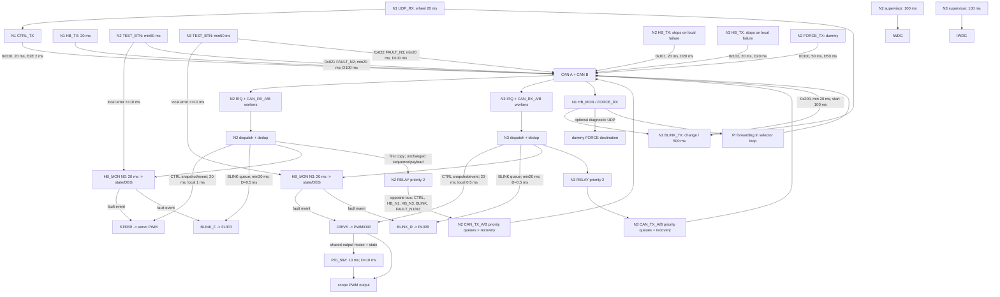

# Relay-enabled task communication graph

This graph is a design artifact for the implemented relay demo, not a timing trace.
All CAN edges below exist on A and B. Local arrows are queues, snapshots or events.

HB_N1 edge is 0x100, 20 ms, D=20 ms. Heartbeat monitor snapshots are shared with
HB_TX. Test/fault task also directly wakes output and blink tasks; its error path
is not delayed until the next HB_MON poll. N1 local test/range faults also emit
0x020 and stop HB_N1. Supervisors read progress from every enabled worker; they do
not send CAN traffic. Recovery shares SPI/controller resources with TX and RX.

Trace these paths in the final timeline figure:

1. Brake/throttle: UDP_RX -> CTRL_TX -> 0x010 -> N3 CAN_RX -> dispatch -> DRIVE -> PWM/DIR.
2. Steering: same to N2 -> STEER -> servo PWM.
3. Blink: UDP_RX -> BLINK_TX -> 0x200 -> each RX/dispatch -> BLINK_F/R -> LED edge.
4. Error: TEST_BTN -> immediate local error/FAULT + stop own HB -> peer HB_MON
   (three missed HB, up to one poll interval) -> DRIVE/brake and hazards.

Label the first three paths with their event-driven response times. The heartbeat
fallback path includes the 60 ms timeout and up to 20 ms polling phase. A real
measured timeline is still required; Mermaid spacing conveys no timing magnitude.

All STM32 local HB/FAULT/FORCE producers enqueue to their CAN_TX_A/B workers;
these workers serialize hardware sends by identifier. The second brake path is
UDP_RX -> CTRL_TX -> A -> N2 RX/dispatch -> RELAY -> TX_B -> B -> N3 RX/dispatch
-> DRIVE. With reversed isolation, swap A and B. All nodes relay; source-ID rejection and bounded dedup suppress returned copies. Dedup suppresses same-bus as well as opposite-bus copies.
